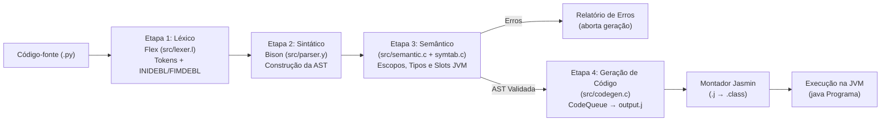
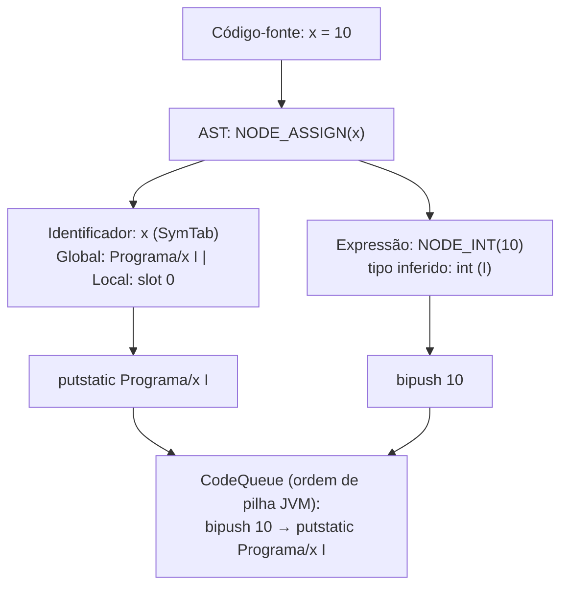
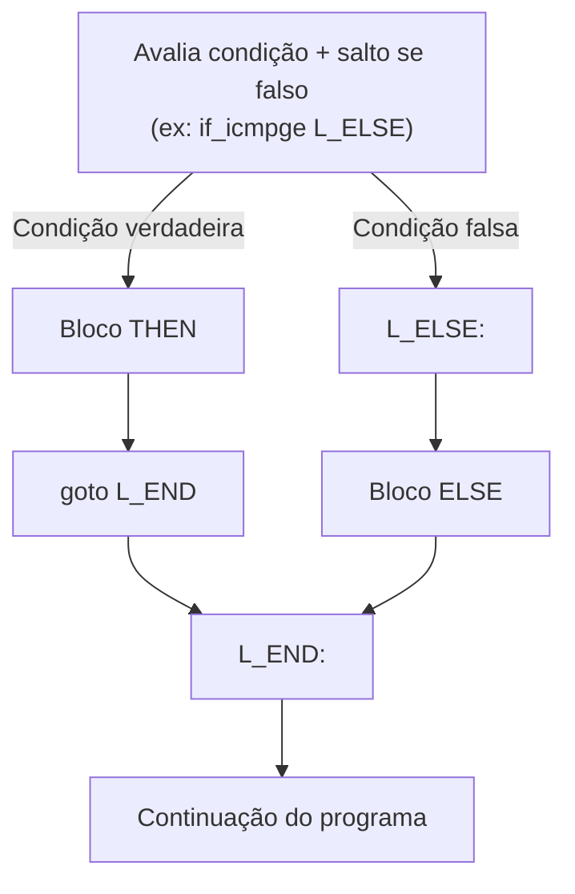

# Compilador Python → JVM (Flex + Bison + Jasmin)

**Disciplina:** COM0002 — Compiladores (Ciência da Computação — UDESC / DCC)  
**Professor:** Ricardo Ferreira Martins  
**Relatório completo em PDF:** [`RELATORIO.pdf`](./RELATORIO.pdf)

Compilador completo para um subconjunto da linguagem **Python**, implementado em **C + Flex + Bison**, com **análise léxica sensível à indentação** (`INIDEBL`/`FIMDEBL`), **análise sintática com construção de Árvore Sintática Abstrata (AST)**, **análise semântica com tabela de símbolos e inferência de tipos** e **geração de código assembly Jasmin** montado em `.class` e executado na **Máquina Virtual Java (JVM / OpenJDK 21)**.

---

## Arquitetura Geral do Compilador



---

## Sumário

1. [Ambiente de Desenvolvimento e Como Executar](#1-ambiente-de-desenvolvimento-e-como-executar)
2. [Estrutura do Projeto](#2-estrutura-do-projeto)
3. [Etapa 1 — Análise Léxica (Flex e Indentação)](#3-etapa-1--análise-léxica-flex-e-indentação)
4. [Etapa 2 — Análise Sintática (Gramática e Bison)](#4-etapa-2--análise-sintática-gramática-e-bison)
5. [Etapa 3 — AST, Tabela de Símbolos e Análise Semântica](#5-etapa-3--ast-tabela-de-símbolos-e-análise-semântica)
6. [Etapa 4 — Geração de Código Jasmin / JVM](#6-etapa-4--geração-de-código-jasmin--jvm)
7. [Análise de Exemplos e Validação (15/15 Testes)](#7-análise-de-exemplos-e-validação-1515-testes)
8. [Conclusão e Limitações Conhecidas](#8-conclusão-e-limitações-conhecidas)
9. [Referências Bibliográficas](#9-referências-bibliográficas)

---

## 1. Ambiente de Desenvolvimento e Como Executar

| Componente | Versão Utilizada |
|---|---|
| Sistema Operacional | Ubuntu 22.04.5 LTS (WSL2) |
| Linguagem do Compilador | C (ISO C11) |
| Flex | `flex 2.6.4` |
| Bison | `GNU Bison 3.8.2` |
| GCC | `gcc 11.4.0` |
| Jasmin | `jasmin-sable 2.5.0` (`/usr/bin/jasmin`) |
| JVM | `OpenJDK 21.0.13` (64-Bit Server VM) |

### Instalação das dependências (Ubuntu / Debian / WSL)

```bash
sudo apt-get update
sudo apt-get install -y flex bison gcc make default-jre jasmin-sable
```

### Compilação e Execução

```bash
# 1. Compilar o compilador (Flex + Bison + GCC -> ./pycomp)
make

# 2. Compilar um arquivo Python, montar no Jasmin e executar na JVM
make run FILE=tests/test1_aritmetica.py

# 3. Executar a suíte automatizada completa (15 testes: 7 válidos na JVM + 8 de erro)
make test

# 4. Inspecionar todas as fases manualmente (tokens, AST e tabela de símbolos)
./pycomp tests/test3_funcoes_recursao.py -o build/output.j --tokens --ast --symtab

# 5. Limpar artefatos de build
make clean
```

### Fluxo manual passo a passo

```bash
./pycomp meu_programa.py -o build/meu_programa.j -c MeuPrograma
cat build/meu_programa.j               # Inspecionar assembly Jasmin gerado
jasmin -d build build/meu_programa.j   # Montar .j -> .class
java -cp build MeuPrograma             # Executar bytecode na JVM
```

---

## 2. Estrutura do Projeto

```text
.
├── Makefile                    # Automação completa (Flex, Bison, GCC, Jasmin, JVM, testes)
├── README.md                   # Documentação completa etapa por etapa
├── RELATORIO.pdf               # Relatório final diagramado em PDF
├── RELATORIO.md                # Fonte em Markdown do relatório
├── src/
│   ├── lexer.l                 # Etapa 1: Scanner Flex + controle de indentação (INIDEBL/FIMDEBL)
│   ├── parser.y                # Etapa 2: Parser Bison (0 conflitos) construindo a AST
│   ├── ast.h / ast.c           # Estruturas da AST, sistema de tipos e descritores JVM
│   ├── symtab.h / symtab.c     # Etapa 3: Tabela de símbolos (globais, funções, slots locais)
│   ├── semantic.h / semantic.c # Etapa 3: Análise semântica em 4 passos + inferência de tipos
│   ├── codegen.h / codegen.c   # Etapa 4: Gerador de código Jasmin com CodeQueue
│   └── main.c                  # Driver CLI (-o, -c, --tokens, --ast, --symtab)
└── tests/
    ├── test1_aritmetica.py     # Inteiros, reais (double), precedência, i2d, // e %
    ├── test2_controle.py       # if/elif/else, and/or/not, while, for range()
    ├── test3_funcoes_recursao.py # Fatorial e Fibonacci recursivos, double, void, pop/pop2
    ├── test4_strings.py        # Concatenação, len, indexação, .upper/.lower, ==/!=
    ├── test5_arrays_listas.py  # Arrays nativos JVM ([0]*n, array()) e Listas (ArrayList)
    ├── test6_globais_import.py # Variáveis/arrays globais entre funções + import math
    ├── test7_compat_etapa2.py  # Compatibilidade com o teste completo da Etapa 2
    ├── errors/                 # 8 casos de erro (léxicos, sintáticos e semânticos)
    └── run_tests.sh            # Script automatizado de verificação (diff na JVM)
```

---

## 3. Etapa 1 — Análise Léxica (Flex e Indentação)

Implementada em [`src/lexer.l`](./src/lexer.l), esta etapa transforma o código-fonte em um fluxo de tokens enriquecidos com linha e coluna exatas (`yylloc` via `YY_USER_ACTION`) e popula a tabela de tokens (`--tokens`).

### Principais responsabilidades
- **Tokens reconhecidos:** palavras-chave (`def`, `return`, `if`, `elif`, `else`, `while`, `for`, `in`, `import`, `global`, `pass`, `and`, `or`, `not`, `True`, `False`), operadores aritméticos (`+`, `-`, `*`, `/`, `//`, `%`), relacionais (`==`, `!=`, `<`, `<=`, `>`, `>=`), delimitadores (`:`, `(`, `)`, `[`, `]`, `,`, `.`), inteiros, reais (`double`), strings com aspas duplas ou simples (decodificando `\n`, `\t`, `\"`, `\'`, `\\`) e identificadores.
- **Blocos por indentação (`INIDEBL` / `FIMDEBL`):**
  - Usa o estado exclusivo `%x LINE_START`, uma pilha de colunas (`indent_stack[128]`, com tabulação equivalente a 4 espaços) e uma fila de recuos pendentes (`pending_dedents`) controlada no wrapper `yylex()`.
  - Linhas vazias e comentários (`#...`) em `<LINE_START>` são ignorados sem alterar a pilha.
  - Aumento de indentação empilha o nível e emite `T_INDENT` (`INIDEBL`); redução desempilha quantos níveis forem necessários emitindo `T_DEDENT` (`FIMDEBL`) consecutivos (e reporta erro léxico em caso de indentação inconsistente).
  - Em `<<EOF>>` (tanto em `<INITIAL>` quanto em `<LINE_START>`), garante a emissão de uma quebra de linha virtual quando necessário e fecha todos os blocos ainda abertos.
- **Detecção de erros léxicos:** identifica lexemas inválidos (ex.: `1a`), caracteres não reconhecidos e recuos inconsistentes, contabilizando `erros_lexicos` para abortar a compilação com segurança.

---

## 4. Etapa 2 — Análise Sintática (Gramática e Bison)

Implementada em [`src/parser.y`](./src/parser.y) com `%locations` e construção *bottom-up* da AST.

### Gramática proposta originalmente

```bnf
<programa>       ::= <lista_comandos>
<lista_comandos> ::= <comando> | <comando> <lista_comandos>
<comando>        ::= <atribuicao> | <expressao> | <if> | <while> | <for> | <funcao> | <return> | <import>
<atribuicao>     ::= <identificador> "=" <expressao>
<expressao>      ::= <termo> | <expressao> "+" <termo> | <expressao> "-" <termo>
<termo>          ::= <fator> | <termo> "*" <fator> | <termo> "/" <fator>
<fator>          ::= <numero> | <identificador> | "(" <expressao> ")"
<if>             ::= "if" <condicao> ":" <bloco>
                   | "if" <condicao> ":" <bloco> "else" ":" <bloco>
<while>          ::= "while" <condicao> ":" <bloco>
<for>            ::= "for" <identificador> "in" <expressao> ":" <bloco>
<funcao>         ::= "def" <identificador> "(" <parametros> ")" ":" <bloco>
<parametros>     ::= ε | <identificador> | <identificador> "," <parametros>
<return>         ::= "return" | "return" <expressao>
<condicao>       ::= <expressao> <op_relacional> <expressao>
<op_relacional>  ::= "==" | "!=" | "<" | ">" | "<=" | ">="
<bloco>          ::= INIDEBL <lista_comandos> FIMDEBL
<identificador>  ::= NOME
<numero>         ::= NUMERO
```

### Adaptação para compilação completa na JVM

Preservando integralmente a gramática proposta, foram incorporadas extensões para suportar procedimentos (`void`), `print(...)`, números reais, strings, arrays nativos, listas dinâmicas, atribuição indexada (`id[i] = expr`), `elif`, operadores lógicos (`and`/`or`/`not`), menos unário, `//`, `%`, `global`, `pass` e chamadas `modulo.funcao(...)` / `objeto.metodo(...)`:

```bnf
programa        → lista_comandos | ε
lista_comandos  → item_comando | lista_comandos item_comando
item_comando    → NEWLINE | comando
comando         → simple_stmt NEWLINE | compound_stmt

simple_stmt     → atribuicao | return_stmt | import_stmt | global_stmt | "pass" | condicao
compound_stmt   → if_stmt | while_stmt | for_stmt | funcao

atribuicao      → ID "=" condicao | ID "[" expressao "]" "=" condicao
import_stmt     → "import" ID
global_stmt     → "global" ID
return_stmt     → "return" | "return" condicao

if_stmt         → "if" condicao ":" bloco elif_chain
elif_chain      → ε | "else" ":" bloco | "elif" condicao ":" bloco elif_chain
while_stmt      → "while" condicao ":" bloco
for_stmt        → "for" ID "in" expressao ":" bloco
funcao          → "def" ID "(" parametros_opt ")" ":" bloco
parametros_opt  → ε | parametros
parametros      → ID | parametros "," ID
bloco           → NEWLINE INIDEBL lista_comandos FIMDEBL

condicao        → and_expr | condicao "or" and_expr
and_expr        → not_expr | and_expr "and" not_expr
not_expr        → rel_expr | "not" not_expr
rel_expr        → expressao | expressao ("==" | "!=" | "<" | "<=" | ">" | ">=") expressao
expressao       → termo | expressao ("+" | "-") termo
termo           → fator | termo ("*" | "/" | "//" | "%") fator
fator           → "-" fator | primary
primary         → INT | REAL | "True" | "False" | STRING | ID
                | ID "(" arg_list_opt ")" | ID "." ID "(" arg_list_opt ")"
                | ID "[" expressao "]" | "[" arg_list_opt "]" | "(" condicao ")"
arg_list_opt    → ε | arg_list
arg_list        → condicao | arg_list "," condicao
```

A precedência e associatividade estão integralmente estruturadas nas regras da gramática, resultando em **0 conflitos shift/reduce e 0 conflitos reduce/reduce** no GNU Bison (`bison -Wcounterexamples`).

---

## 5. Etapa 3 — AST, Tabela de Símbolos e Análise Semântica

Como Python não declara tipos explicitamente em variáveis ou parâmetros (`def soma(x, y):`), a fase semântica atua sobre a **AST** (`src/ast.c`) em conjunto com a **Tabela de Símbolos** (`src/symtab.c`) e o **Analisador Semântico** (`src/semantic.c`).

### Tabela de Símbolos Especializada (`src/symtab.c`)

1. **Variáveis globais (`globals`):** todas as variáveis de nível superior — viram `.field public static <nome> <descritor>` e são acessadas com `getstatic`/`putstatic`.
2. **Variáveis locais por função (`FuncSym.locals` e `main_locals`):** cada parâmetro e variável local recebe seu **índice exato de slot no frame JVM** (`double` ocupa **2 slots**; `int`, `bool` e referências ocupam **1 slot**; em `main`, o slot `0` é reservado a `String[] args`).
3. **Funções e procedimentos (`funcs`):** registra parâmetros, tipos inferidos, retorno (`I`, `D`, `Ljava/lang/String;`, `[I`, `Ljava/util/ArrayList;` ou `V`) e quantidade total de slots, montando automaticamente descritores JVM como `(ID)D` e `([I)I`.
4. **Módulos importados (`imports`):** controla os módulos declarados com `import` (como `math`).

### Análise Semântica em 4 Passos (`src/semantic.c`)

1. **Coleta inicial:** registra todas as funções `def` (rejeitando duplicatas de função ou parâmetro), `import` e declarações `global` internas.
2. **Inferência de tipos por ponto fixo:** propaga tipos em atribuições, chamadas de função (inclusive recursivas, como `fat` e `fib`), promoção automática `int → double` e listas vazias `[]` tipadas no primeiro `.append(...)`.
3. **Alocação exata de slots JVM:** recalcula os slots locais após a convergência dos tipos, garantindo que variáveis promovidas para `double` não colidam com o slot seguinte.
4. **Validação final e vinculação da AST:** emite diagnósticos precisos com linha e coluna (variável não declarada, aridade incorreta, tipos incompatíveis, índice não inteiro, módulo não importado, `return` fora de função ou retorno incompatível) e aloca slots ocultos para laços `for` (suportando aninhamento) e inicialização de arrays.

### Fluxo de tradução de uma atribuição (`x = 10`)



---

## 6. Etapa 4 — Geração de Código Jasmin / JVM

Implementada em [`src/codegen.c`](./src/codegen.c), utiliza uma fila encadeada **`CodeQueue`** (inserção em tempo O(1)) para montar todo o arquivo `output.j` em memória e gravá-lo em disco apenas quando não há erros:

- Cabeçalho `.class public <Classe>` e `.super java/lang/Object`;
- Campos estáticos `.field public static` para globais;
- Construtor `<init>()V` com `invokespecial java/lang/Object/<init>()V`;
- Um método `.method public static` para cada `def`;
- Método `.method public static main([Ljava/lang/String;)V` contendo os comandos de nível superior.

### Fluxo de desvios gerado para `if` / `else`



### Tabela de Mapeamento Python → JVM (Jasmin)

| Recurso Python | Descritor JVM | Instruções Jasmin Utilizadas |
|---|---|---|
| `int` | `I` (1 slot) | `iconst_n`, `bipush`, `sipush`, `ldc`, `iload`/`istore`, `iadd`, `isub`, `imul`, `idiv`, `irem`, `ineg`, `if_icmp*`, `ireturn`, `pop` |
| `double` (real) | `D` (2 slots) | `dconst_0`/`1`, `ldc2_w`, `dload`/`dstore`, `i2d`, `d2i`, `dadd`, `dsub`, `dmul`, `ddiv`, `dneg`, `dcmpg` + `if*`, `dreturn`, `pop2` |
| `string` | `Ljava/lang/String;` | `ldc "..."`, `aload`/`astore`, `StringBuilder` (`+`), `String.equals` (`==`/`!=`), `length()`, `substring(II)`, `toUpperCase()`, `toLowerCase()` |
| Arrays nativos (`[0]*n`, `array(...)`) | `[I`, `[D`, `[Ljava/lang/String;` | `newarray int/double`, `anewarray java/lang/String`, `iaload`/`iastore`, `daload`/`dastore`, `aaload`/`aastore`, `arraylength`, `Arrays.toString` |
| Listas dinâmicas (`[...]`, `[]`) | `Ljava/util/ArrayList;` | `new java/util/ArrayList`, boxing (`Integer/Double.valueOf`), `add`, `get`, `set`, `remove`, `size`, `clear`, unboxing (`intValue`/`doubleValue`) |
| `print(...)` / `import math` | `PrintStream` / `Math` | `System.out.println(...)`, `invokestatic java/lang/Math/sqrt\|pow\|floor\|ceil\|sin\|cos\|abs` |

---

## 7. Análise de Exemplos e Validação (15/15 Testes)

Todos os 7 testes positivos abaixo são compilados pelo `./pycomp`, montados pelo `jasmin 2.5.0` e executados no `OpenJDK 21` com verificação automática da saída (`make test`):

| Teste | Recursos Exercitados | Saída na JVM |
|---|---|---|
| [`tests/test1_aritmetica.py`](./tests/test1_aritmetica.py) | Inteiros, divisão inteira (`/` e `//`), `%`, `-` unário, reais (`double`), promoção `i2d`, `float()`/`int()` | `6`, `5 2 -6`, `23.0`, `2.5`, `2` |
| [`tests/test2_controle.py`](./tests/test2_controle.py) | `if`/`elif`/`else` aninhados, `and`/`or`/`not`, `while`, `for` com `range` crescente e decrescente | `4, 3, 2, 1`, `B`, `logica ok`, `15`, `6, 4, 2` |
| [`tests/test3_funcoes_recursao.py`](./tests/test3_funcoes_recursao.py) | Fatorial recursivo, Fibonacci recursivo, `media(ID)D`, procedimento `void`, descarte (`pop`/`pop2`) | `=== Funcoes e Recursao ===`, `120`, `13`, `7.75`, `fim` |
| [`tests/test4_strings.py`](./tests/test4_strings.py) | Concatenação `+`, `len()`, `s[i]`, `.upper()`/`.lower()`, `==`/`!=`, `str()`, retorno de string | `Compiladores - Python`, `21`, `P n`, `PYTHON`, `python`, `comparacao ok`, `Ola, UDESC!`, `Numero: 2026` |
| [`tests/test5_arrays_listas.py`](./tests/test5_arrays_listas.py) | Arrays nativos (`[0]*3`, `array(float, [...])`, `["oi"]*2`), listas (`ArrayList`, `.append`, `.pop`, `[]`), arrays/listas como parâmetros | `30, 20, 10, 60`, `[10, 20, 30]`, `7.5`, `3`, `[oi, jvm]`, `[100, 250, 300]`, `3`, `300`, `Ana`, `Bruno`, `60`, `[100, 250, 100]` |
| [`tests/test6_globais_import.py`](./tests/test6_globais_import.py) | Variáveis e arrays globais (`x`, `arr`, `global contador`), funções (`pow_int`, `dobro`, `incrementar`), `import math` | `125`, `6`, `12345`, `2`, `4.0`, `8.0`, `3.0` |
| [`tests/test7_compat_etapa2.py`](./tests/test7_compat_etapa2.py) | Compatibilidade direta com o teste completo da Etapa 2 | `4, 3, 2, 1, 0`, `24.0`, `Compiladores etapa 2` |

### Exemplo de código Jasmin gerado (`fat(I)I` e `media(ID)D`)

```jasmin
.method public static fat(I)I
    .limit stack 64
    .limit locals 2
    iload 0
    iconst_1
    if_icmpne L0
    iconst_1
    ireturn
    goto L1
L0:
    iload 0
    iload 0
    iconst_1
    isub
    invokestatic Programa/fat(I)I
    imul
    istore 1
    iload 1
    ireturn
L1:
    iconst_0
    ireturn
.end method

.method public static media(ID)D
    .limit stack 64
    .limit locals 3
    iload 0
    i2d
    dload 1
    dadd
    ldc2_w 2.0
    ddiv
    dreturn
    dconst_0
    dreturn
.end method
```

### Validação dos 8 casos de erro (`tests/errors/`)

```text
[PASS] err1_lexico            -> [ERRO LEXICO]    Linha 2, Coluna 1: Identificador invalido '1a'
[PASS] err2_sintatico         -> [ERRO SINTATICO] Linha 4, Coluna 10: syntax error proximo ao token '('
[PASS] err3_var_nao_declarada -> [ERRO SEMANTICO] Linha 2, Coluna 5: Variavel 'y' utilizada antes de ser declarada
[PASS] err4_tipo_incompativel -> [ERRO SEMANTICO] Linha 2, Coluna 8: Operacao '+' incompativel entre 'int' e 'string'
[PASS] err5_aridade           -> [ERRO SEMANTICO] Linha 5, Coluna 5: Funcao 'soma' espera 2 argumento(s), mas recebeu 1
[PASS] err6_sem_import        -> [ERRO SEMANTICO] Linha 2, Coluna 5: Modulo 'math' nao importado (adicione 'import math')
[PASS] err7_indice_invalido   -> [ERRO SEMANTICO] Linha 3, Coluna 7: Indice de acesso deve ser int, recebeu 'double'
[PASS] err8_return_fora       -> [ERRO SEMANTICO] Linha 2, Coluna 1: 'return' fora de funcao

Resumo: 15 passaram, 0 falharam.
```

---

## 8. Conclusão e Limitações Conhecidas

O compilador integra na prática todas as etapas de compilação: análise léxica sensível à indentação, análise sintática LALR livre de conflitos, AST, análise semântica com inferência de tipos e gerenciamento de frames JVM, e geração de código bytecode executável no OpenJDK 21.

**Limitações conhecidas e evoluções futuras:**
- **Coleções homogêneas:** cada array ou lista possui um tipo único de elemento (`int`, `double` ou `string`), reflexo da tipagem estática da JVM.
- **Assinatura única por função:** cada `def` gera um método estático JVM cuja assinatura é inferida a partir das chamadas (com promoção `int → double`); uma evolução natural seria *monomorfização* para múltiplas assinaturas distintas.
- **Extensões futuras:** dicionários (`dict`), fatiamento (*slicing*), `break`/`continue` e classes definidas pelo usuário sobre a mesma AST.

---

## 9. Referências Bibliográficas

- AHO, Alfred V. et al. *Compilers: principles, techniques, and tools*. 2nd ed. Pearson, 2007.
- COOPER, Keith D.; TORCZON, Linda. *Construindo compiladores*. Elsevier, 2014.
- LINDHOLM, Tim; YELLIN, Frank. *The Java Virtual Machine Specification*. 2nd ed. Addison-Wesley.
- MARTINS, Ricardo F. *FLEX: Introdução ao Flex* e *BISON: Visão geral BISON+FLEX*. Material da disciplina COM0002 — UDESC/DCC.
- MEYER, Jonathan. *Jasmin User Guide*. Disponível em: <http://jasmin.sourceforge.net/guide.html>.
- GNU Bison 3.8 Documentation: <https://www.gnu.org/software/bison/manual/bison.html>.
- Flex Documentation: <https://github.com/westes/flex>.
