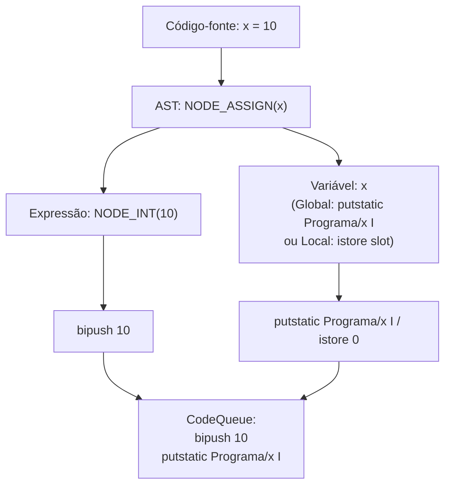
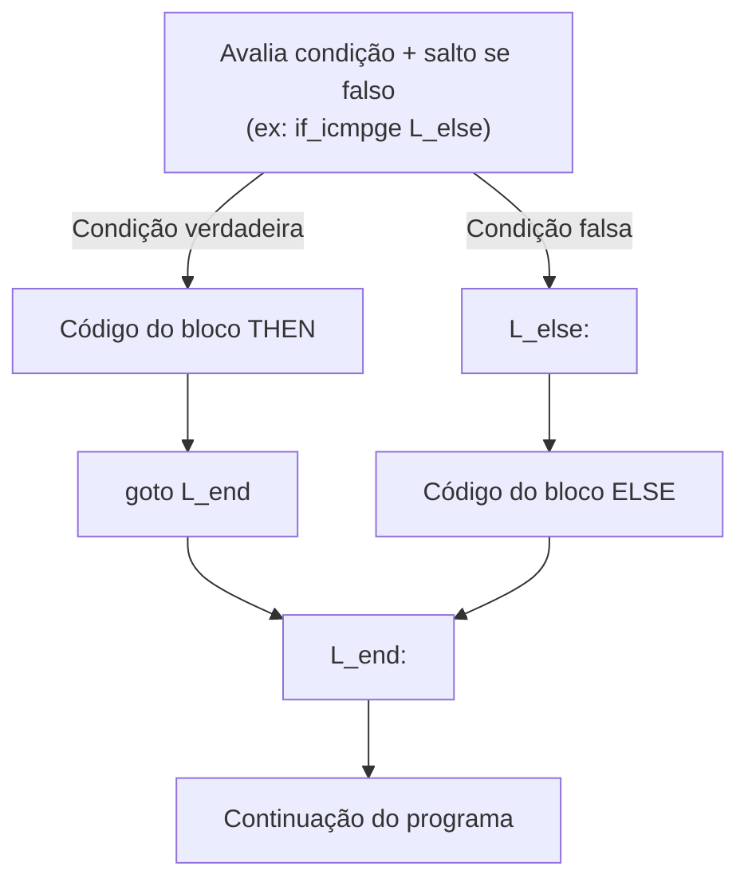

# Compiladores: Trabalho Final

**Disciplina:** COM0002 — Compiladores (Ciência da Computação — UDESC)  
**Professor:** Ricardo Ferreira Martins  

---

## Escopo do projeto

Desenvolver um compilador utilizando **Flex**, **Bison** e **Jasmin** (montador para a JVM), para uma gramática baseada na linguagem **Python**, com suporte à análise léxica (incluindo blocos por indentação), análise sintática, análise semântica (tabela de símbolos, controle de escopos e inferência/verificação de tipos) e geração de código bytecode executável na Máquina Virtual Java (JVM), abrangendo números inteiros, números reais (`double`), strings, arrays nativos JVM e listas dinâmicas.

### Figura 1: Gramática proposta

```bnf
<programa>       ::= <lista_comandos>

<lista_comandos> ::= <comando> | <comando> <lista_comandos>

<comando>        ::= <atribuicao>
                   | <expressao>
                   | <if>
                   | <while>
                   | <for>
                   | <funcao>
                   | <return>
                   | <import>

<atribuicao>     ::= <identificador> "=" <expressao>

<expressao>      ::= <termo>
                   | <expressao> "+" <termo>
                   | <expressao> "-" <termo>

<termo>          ::= <fator>
                   | <termo> "*" <fator>
                   | <termo> "/" <fator>

<fator>          ::= <numero>
                   | <identificador>
                   | "(" <expressao> ")"

<if>             ::= "if" <condicao> ":" <bloco>
                   | "if" <condicao> ":" <bloco> "else" ":" <bloco>

<while>          ::= "while" <condicao> ":" <bloco>

<for>            ::= "for" <identificador> "in" <expressao> ":" <bloco>

<funcao>         ::= "def" <identificador> "(" <parametros> ")" ":" <bloco>

<parametros>     ::= ε
                   | <identificador>
                   | <identificador> "," <parametros>

<return>         ::= "return"
                   | "return" <expressao>

<condicao>       ::= <expressao> <op_relacional> <expressao>

<op_relacional>  ::= "==" | "!=" | "<" | ">" | "<=" | ">="

<bloco>          ::= INIDEBL <lista_comandos> FIMDEBL

<identificador>  ::= NOME

<numero>         ::= NUMERO
```

> **Observação:** Além dos terminais explícitos (`<=`, `def`, etc.), existem terminais de forma variada (`NUMERO`, `NOME`), bem como `INIDEBL` (aumento de indentação/tabulação que abre um bloco) e `FIMDEBL` (recuo de indentação que encerra um bloco).

---

## Sumário dos Resultados

1. Descrição do ambiente de desenvolvimento (compilação, ambiente e linguagem);
2. Adaptação da gramática;
3. Especificação FLEX;
4. Especificação BISON;
5. Comentários sobre a implementação;
6. Geração de código;
7. Análise de exemplos;
8. Conclusão;
9. Referências Bibliográficas.

---

## 1. Descrição do ambiente de desenvolvimento

- **Sistema operacional:** Ubuntu 22.04.5 LTS (WSL2)
- **Linguagem de implementação do compilador:** C (ISO C11)
- **Flex:** `flex 2.6.4`
- **Bison:** `bison (GNU Bison) 3.8.2`
- **Jasmin:** `jasmin-sable 2.5.0` (`/usr/bin/jasmin`)
- **GCC:** `gcc (Ubuntu 11.4.0-1ubuntu1~22.04.3) 11.4.0`
- **JVM:** `OpenJDK 21.0.13` (64-Bit Server VM)

### Como compilar e utilizar este programa

O projeto foi estruturado na pasta `parte3/` com um `Makefile` que automatiza toda a cadeia de compilação (geração do parser Bison, geração do lexer Flex, compilação com GCC, geração de código Jasmin `.j`, montagem para `.class` e execução na JVM).

```bash
# 1. Compilar o compilador (gera o executável ./pycomp)
make

# 2. Compilar um arquivo Python, montar no Jasmin e executar na JVM
make run FILE=tests/test1_aritmetica.py

# 3. Executar a suíte automatizada completa (15 testes positivos e negativos)
make test

# 4. Inspecionar tabela de tokens, AST e tabela de símbolos manualmente
./pycomp tests/test3_funcoes_recursao.py -o build/output.j --tokens --ast --symtab

# 5. Limpar artefatos gerados
make clean
```

Para testar um programa próprio, basta criar um arquivo `.py` respeitando a sintaxe implementada e executar `make run FILE=seu_arquivo.py`.

---

## 2. Adaptação da gramática

Para viabilizar a compilação completa de programas em Python para a JVM, mantendo total aderência à gramática proposta na Figura 1, foram incorporadas as seguintes extensões naturais:

- **Funções e Procedimentos:** Funções `def` que contêm `return <expressao>` são compiladas como métodos tipados (`I`, `D`, `Ljava/lang/String;`, etc.), enquanto funções sem retorno de valor (ou com `return` vazio) são compiladas como procedimentos `void` (`V`).
- **Impressão (`print`) e funções embutidas:** Suporte a `print(...)` com um ou mais argumentos de qualquer tipo (`int`, `double`, `bool`, `string`, arrays e listas), além de `len(...)`, `range(...)`, `array(...)`, `int(...)`, `float(...)`, `str(...)` e `abs(...)`.
- **Tipos de dados ampliados:** Além de inteiros (`T_INT`), foram adicionados números reais (`T_REAL` → `double`), strings com aspas duplas ou simples (`T_STRING` → `java.lang.String`), booleanos (`True`/`False`), **arrays nativos da JVM** (`[val] * n` e `array(tipo, tamanho_ou_lista)`) e **listas dinâmicas** (`[e1, e2, ...]`, `[]`, `.append()`, `.pop()`, `.clear()`).
- **Atribuição e acesso indexado:** Suporte a `id[expressao]` para leitura e `id[expressao] = condicao` para escrita em arrays e listas.
- **Operadores adicionais e controle de fluxo:** Operadores lógicos (`and`, `or`, `not`), `elif`, menos unário (`-fator`), divisão inteira explícita (`//`), módulo (`%`), declaração `global <id>`, comando `pass` e chamadas de módulo/método `id.metodo(args)` (por exemplo, `import math` com `math.sqrt`, `math.pow`, `math.floor`, `math.ceil`, `math.sin`, `math.cos`, `math.fabs`).

### Gramática estendida implementada

```bnf
programa        → lista_comandos | ε
lista_comandos  → item_comando | lista_comandos item_comando
item_comando    → NEWLINE | comando
comando         → simple_stmt NEWLINE | compound_stmt

simple_stmt     → atribuicao | return_stmt | import_stmt | global_stmt | "pass" | condicao
compound_stmt   → if_stmt | while_stmt | for_stmt | funcao

atribuicao      → ID "=" condicao
                | ID "[" expressao "]" "=" condicao
import_stmt     → "import" ID
global_stmt     → "global" ID
return_stmt     → "return" | "return" condicao

if_stmt         → "if" condicao ":" bloco elif_chain
elif_chain      → ε
                | "else" ":" bloco
                | "elif" condicao ":" bloco elif_chain
while_stmt      → "while" condicao ":" bloco
for_stmt        → "for" ID "in" expressao ":" bloco
funcao          → "def" ID "(" parametros_opt ")" ":" bloco
parametros_opt  → ε | parametros
parametros      → ID | parametros "," ID
bloco           → NEWLINE INIDEBL lista_comandos FIMDEBL

condicao        → and_expr | condicao "or" and_expr
and_expr        → not_expr | and_expr "and" not_expr
not_expr        → rel_expr | "not" not_expr
rel_expr        → expressao | expressao op_relacional expressao
op_relacional   → "==" | "!=" | "<" | "<=" | ">" | ">="

expressao       → termo | expressao "+" termo | expressao "-" termo
termo           → fator | termo "*" fator | termo "/" fator
                | termo "//" fator | termo "%" fator
fator           → "-" fator | primary

primary         → INT | REAL | "True" | "False" | STRING | ID
                | ID "(" arg_list_opt ")"
                | ID "." ID "(" arg_list_opt ")"
                | ID "[" expressao "]"
                | "[" arg_list_opt "]"
                | "(" condicao ")"
arg_list_opt    → ε | arg_list
arg_list        → condicao | arg_list "," condicao
```

A precedência e a associatividade dos operadores estão integralmente codificadas nos níveis não-terminais da gramática, resultando em **0 conflitos shift/reduce** e **0 conflitos reduce/reduce** no GNU Bison (`bison -Wcounterexamples`).

---

## 3. Especificação FLEX

A especificação léxica encontra-se no arquivo `src/lexer.l` e implementa duas responsabilidades principais:

1. **Reconhecimento de tokens e literais:** Expressões regulares para palavras-chave (`def`, `return`, `if`, `elif`, `else`, `while`, `for`, `in`, `import`, `global`, `pass`, `and`, `or`, `not`, `True`, `False`), operadores aritméticos e relacionais, delimitadores (`:`, `(`, `)`, `[`, `]`, `,`, `.`), inteiros (`[0-9]+`), reais (`[0-9]+"."[0-9]+`), strings com suporte a sequências de escape (`\n`, `\t`, `\"`, `\'`, `\\`), identificadores (`[a-zA-Z_][a-zA-Z0-9_]*`) e detecção de erros léxicos (como identificadores iniciados por dígito `1a` e caracteres inválidos).
2. **Controle de indentação (`INIDEBL` / `FIMDEBL`):** Utiliza o estado exclusivo `%x LINE_START`, uma pilha de níveis de indentação (`indent_stack[128]`, com tabulação equivalente a 4 espaços) e uma fila de recuos pendentes (`pending_dedents`) encapsulada na função `yylex()`:
   - Linhas em branco e linhas de comentário (`#...`) em `<LINE_START>` são descartadas sem alterar a pilha de indentação.
   - Um aumento de coluna em relação ao topo da pilha empilha o novo nível e emite `T_INDENT` (`INIDEBL`).
   - Uma redução de coluna desempilha tantos níveis quantos forem necessários, emitindo múltiplos `T_DEDENT` (`FIMDEBL`) consecutivos (e reportando erro léxico de indentação inconsistente caso o nível não corresponda a nenhum valor empilhado).
   - Ao atingir `<<EOF>>` em `<INITIAL>` ou `<LINE_START>`, garante a emissão de uma quebra de linha virtual (caso a última linha não termine com `\n`) seguida de todos os `T_DEDENT` pendentes, fechando corretamente blocos no final do arquivo.
   - Mantém o rastreamento exato de linha e coluna via `YY_USER_ACTION` preenchido em `yylloc`, além da tabela completa de tokens (`exibir_tabela_tokens`).

---

## 4. Especificação BISON

A especificação sintática encontra-se no arquivo `src/parser.y`, organizada nas quatro seções clássicas do Bison:

- **`%code requires` e Prólogo (`%{ ... %}`):** Inclusão de `ast.h`, habilitação de `%locations` para localização precisa de cada nó na árvore (`@1.first_line`, `@1.first_column`) e declaração de `ast_root` e `erros_sintaticos`.
- **Declarações (`%union`, `%token`, `%type`, `%start`):** Define a união semântica contendo inteiros (`ival`), reais (`fval`), strings (`sval`) e ponteiros para nós da AST (`ASTNode *node`).
- **Regras Gramaticais:** Implementa a gramática Python adaptada, construindo nós tipados da AST em estratégia *bottom-up* por meio dos construtores em `src/ast.c`.
- **Epílogo:** Define `yyerror`, que contabiliza erros sintáticos e exibe linha, coluna e o token próximo ao erro.

---

## 5. Comentários sobre a implementação

Para desacoplar o reconhecimento sintático da tipagem estática exigida pela JVM, o compilador foi modularizado em C em seis componentes (`src/lexer.l`, `src/parser.y`, `src/ast.c`, `src/symtab.c`, `src/semantic.c`, `src/codegen.c` e `src/main.c`).

### Construção da AST e Estratégia de Compilação

Como Python não exige declarações explícitas de tipos em variáveis (`x = 10`) ou parâmetros de funções (`def soma(x, y):`), o Bison constrói primeiro a **Árvore Sintática Abstrata (AST)** de forma *bottom-up*. Em seguida, o analisador semântico realiza uma inferência de tipos por ponto fixo e o gerador de código emite as instruções Jasmin em uma estrutura de fila encadeada chamada **`CodeQueue`** (que acumula as instruções em memória em tempo $O(1)$ por emissão e grava o arquivo `.j` de uma só vez, reduzindo I/O em disco e evitando a escrita de saída parcial em caso de erro).

O diagrama abaixo ilustra o fluxo de tradução da atribuição `x = 10` desde o código-fonte até o bytecode Jasmin gerado:



### Tabela de Símbolos Especializada (`src/symtab.c`)

Seguindo a separação de contextos exigida pela JVM, a tabela de símbolos mantém estruturas especializadas:

1. **Lista de variáveis globais (`globals`):** Armazena nome, tipo inferido (`int`, `double`, `string`, `int[]`, `ArrayList`, etc.) e linha de declaração de todas as variáveis definidas no escopo de nível superior. Cada entrada gera um campo `.field public static <nome> <descritor>` na classe JVM.
2. **Lista de variáveis locais por função (`FuncSym.locals` e `main_locals`):** Guarda nome, tipo, papel (parâmetro ou variável local) e o **índice exato do slot no frame da JVM**. Variáveis de 64 bits (`double`) consomem **2 slots** consecutivos no frame, enquanto `int`, `bool` e referências (`String`, arrays, `ArrayList`) consomem **1 slot**. Na `main([Ljava/lang/String;)V`, o slot `0` é reservado para `args`.
3. **Lista de funções/procedimentos (`funcs`):** Armazena nome, lista e tipos inferidos dos parâmetros, tipo de retorno (`I`, `D`, `Ljava/lang/String;`, `V`, etc.), número total de slots locais e referência para o nó `NODE_FUNC_DEF`, permitindo montar automaticamente descritores JVM como `(ID)D` ou `([I)I`.
4. **Lista de módulos importados (`imports`):** Registra módulos declarados com `import` (como `math`), validando na fase semântica se o módulo foi importado antes de qualquer chamada `math.<funcao>(...)`.

### Análise Semântica em 4 Passos (`src/semantic.c`)

1. **Coleta inicial:** Registra todas as declarações `def` (verificando funções e parâmetros duplicados), `import` e declarações `global` dentro de funções.
2. **Inferência de tipos (ponto fixo):** Propaga tipos entre atribuições, chamadas de função (incluindo recursão e promoção `int → double`) e listas inicialmente vazias (`[]` tipadas no primeiro `.append(...)`).
3. **Alocação exata de slots JVM:** Após a estabilização dos tipos, calcula os índices de frame (`0, 1, 2...`) garantindo que variáveis promovidas para `double` recebam 2 slots sem sobreposição.
4. **Validação final e vinculação da AST:** Verifica e reporta erros semânticos (variável não declarada, aridade incorreta, tipos incompatíveis, índice não inteiro, `return` fora de função ou retorno incompatível, módulo não importado) e aloca slots ocultos para contadores de laços `for` (suportando laços aninhados) e inicialização de arrays.

---

## 6. Geração de código

A geração de código (`src/codegen.c`) traduz a AST validada em um arquivo assembly Jasmin (`.j`) contendo:

- Diretivas `.class public <Classe>` e `.super java/lang/Object`;
- Campos estáticos `.field public static` para variáveis globais;
- Construtor padrão `.method public <init>()V` invocando `invokespecial java/lang/Object/<init>()V`;
- Um método `.method public static <nome>(<desc_params>)<desc_ret>` para cada `def`;
- O método `.method public static main([Ljava/lang/String;)V` contendo os comandos executáveis de nível superior.

### Mapeamento de Controle de Fluxo (`if` / `else`)

Para estruturas condicionais `if`/`else`, o gerador avalia os operandos da condição, emite um salto condicional invertido para o rótulo do bloco `else` (`L_else`) caso a condição seja falsa e um `goto` ao final do bloco `then` para o rótulo de continuação (`L_end`):



No `while`, um rótulo `L_cond` precede a avaliação da condição, que salta para `L_end` quando falsa, e o corpo termina com `goto L_cond`. Em `and`/`or`/`not`, é utilizada avaliação em curto-circuito diretamente sobre os saltos.

### Mapeamento de Tipos, Arrays e Listas na JVM

| Recurso Python | Representação JVM | Instruções Jasmin Principais |
|---|---|---|
| `int` | `I` (32 bits, 1 slot) | `iconst_n`, `bipush`, `sipush`, `ldc`, `iload`/`istore`, `iadd`, `isub`, `imul`, `idiv`, `irem`, `ineg`, `if_icmp*`, `ireturn` |
| `double` (real) | `D` (64 bits, 2 slots) | `dconst_0`/`1`, `ldc2_w`, `dload`/`dstore`, `i2d`, `d2i`, `dadd`, `dsub`, `dmul`, `ddiv`, `dneg`, `dcmpg` + `if*`, `dreturn`, `pop2` |
| `string` | `Ljava/lang/String;` | `ldc "..."`, `aload`/`astore`, `StringBuilder.append/toString` (`+`), `String.equals` (`==`/`!=`), `String.length`, `substring` |
| Arrays nativos (`[0]*n`, `array(...)`) | `[I`, `[D`, `[Ljava/lang/String;` | `newarray int`, `newarray double`, `anewarray java/lang/String`, `iaload`/`iastore`, `daload`/`dastore`, `aaload`/`aastore`, `arraylength`, `Arrays.toString` |
| Listas dinâmicas (`[...]`, `[]`) | `Ljava/util/ArrayList;` | `new java/util/ArrayList`, `Integer.valueOf`/`Double.valueOf`, `add`, `get`, `set`, `remove`, `size`, `checkcast` + `intValue`/`doubleValue` |
| `print(...)` | `java/io/PrintStream` | `getstatic java/lang/System/out` + `invokevirtual java/io/PrintStream/println(...)V` |
| `import math` | `java/lang/Math` | `invokestatic java/lang/Math/sqrt(D)D`, `pow(DD)D`, `floor(D)D`, `ceil(D)D`, `sin(D)D`, `cos(D)D`, `abs(D)D` |

---

## 7. Análise de exemplos

Todos os exemplos abaixo estão disponíveis em `parte3/tests/` e podem ser compilados e executados diretamente com `make run FILE=<arquivo>` ou validados em lote com `make test`.

### 7.1 Operadores aritméticos, precedência, inteiros e reais (`tests/test1_aritmetica.py`)

Demonstra precedência aritmética, divisão inteira (`/` e `//`), módulo (`%`), menos unário, números reais (`double`), promoção implícita `int → double` (`i2d`) e conversões explícitas `float()`/`int()`.

```python
x = 5
y = 4
z = y
k = z + 5 * x / 10
print(k)

q = 17 // 3
r = 17 % 3
neg = -k
print(q, r, neg)

a = 10.5
b = 2
res = a * b + (x - 1) / 2
print(res)

f = float(x) / 2.0
print(f)
print(int(f))
```

**Execução e saída na JVM (`make run FILE=tests/test1_aritmetica.py`):**

```text
6
5 2 -6
23.0
2.5
2
```

---

### 7.2 Estruturas de repetição, condicionais e operadores lógicos (`tests/test2_controle.py`)

Combina `if`/`else` aninhados para encontrar o menor entre três valores, laço `while` decrescente, cadeia `if`/`elif`/`else` com operadores lógicos (`and`, `or`, `not`) e laços `for` com `range(ini, fim)` e passo negativo `range(6, 0, -2)`.

```python
a = 4
b = 5
c = 6

if b < a:
    if b < c:
        menor = b
    else:
        menor = c
else:
    menor = a

while menor > 0:
    print(menor)
    menor = menor - 1

nota = 7.5
if nota >= 9.0:
    print("A")
elif nota >= 7.0 and nota < 9.0:
    print("B")
else:
    print("C")

if not (a == b) and (c > b or a > 100):
    print("logica ok")

soma = 0
for i in range(1, 6):
    soma = soma + i
print(soma)

for j in range(6, 0, -2):
    print(j)
```

**Saída na JVM:**

```text
4
3
2
1
B
logica ok
15
6
4
2
```

---

### 7.3 Funções, procedimentos e recursão: fatorial e Fibonacci (`tests/test3_funcoes_recursao.py`)

Demonstra recursão (`fat` e `fib`), inferência de múltiplos tipos de parâmetros e retorno real (`media(ID)D`), procedimento sem retorno (`mostrar_cabecalho(Ljava/lang/String;)V`) e descarte correto de retorno com `pop` (`int`) e `pop2` (`double`).

```python
def fat(num):
    if num == 1:
        return 1
    else:
        x = num * fat(num - 1)
        return x

def fib(n):
    if n <= 1:
        return n
    return fib(n - 1) + fib(n - 2)

def media(a, b):
    return (a + b) / 2.0

def mostrar_cabecalho(titulo):
    print(titulo)

mostrar_cabecalho("=== Funcoes e Recursao ===")
x = 5
a = fat(x)
print(a)
print(fib(7))
m = media(7, 8.5)
print(m)

fat(3)
media(1, 2.0)
print("fim")
```

**Trecho do código Jasmin gerado (`fat` e `media`):**

```jasmin
.method public static fat(I)I
    .limit stack 64
    .limit locals 2
    iload 0
    iconst_1
    if_icmpne L0
    iconst_1
    ireturn
    goto L1
L0:
    iload 0
    iload 0
    iconst_1
    isub
    invokestatic Programa/fat(I)I
    imul
    istore 1
    iload 1
    ireturn
L1:
    iconst_0
    ireturn
.end method

.method public static media(ID)D
    .limit stack 64
    .limit locals 3
    iload 0
    i2d
    dload 1
    dadd
    ldc2_w 2.0
    ddiv
    dreturn
    dconst_0
    dreturn
.end method
```

**Saída na JVM:**

```text
=== Funcoes e Recursao ===
120
13
7.75
fim
```

---

### 7.4 Strings (`tests/test4_strings.py`)

Demonstra manipulação de strings: concatenação via `StringBuilder`, medição de comprimento (`len`), indexação (`s[i]`), métodos `.upper()` e `.lower()`, comparação de conteúdo (`String.equals`), conversão `str(2026)` e passagem/retorno de strings em funções.

```python
def saudar(nome):
    return "Ola, " + nome + "!"

s1 = "Compiladores"
s2 = "Python"
frase = s1 + " - " + s2
print(frase)
print(len(frase))
print(s2[0], s2[5])
print(s2.upper())
print(s2.lower())

if s2 == "Python" and s1 != s2:
    print("comparacao ok")

msg = saudar("UDESC")
print(msg)
print("Numero: " + str(2026))
```

**Saída na JVM:**

```text
Compiladores - Python
21
P n
PYTHON
python
comparacao ok
Ola, UDESC!
Numero: 2026
```

---

### 7.5 Arrays nativos JVM e Listas dinâmicas (`tests/test5_arrays_listas.py`)

Demonstra tanto **arrays nativos da JVM** (`[0] * 3`, `array(float, [1.5, 2.5, 3.5])`, `["oi"] * 2`) quanto **listas dinâmicas (`ArrayList`)** (`[100, 200]`, lista vazia `[]` com inferência via `.append()`, `.pop()`, atribuição indexada `lista[1] = 250`, `len()`, iteração `for` e passagem como parâmetros para funções).

```python
x = [0] * 3
x[0] = 10
x[1] = 20
x[2] = 30

soma = 0
y = 3
while y > 0:
    y = y - 1
    v = x[y]
    print(v)
    soma = soma + x[y]
print(soma)
print(x)

reais = array(float, [1.5, 2.5, 3.5])
soma_r = 0.0
for r in reais:
    soma_r = soma_r + r
print(soma_r)
print(len(reais))

palavras = ["oi"] * 2
palavras[1] = "jvm"
print(palavras)

lista = [100, 200]
lista.append(300)
lista[1] = 250
print(lista)
print(len(lista))
removido = lista.pop()
print(removido)

nomes = []
nomes.append("Ana")
nomes.append("Bruno")
for nome in nomes:
    print(nome)

def somar_elementos(colecao):
    total = 0
    for item in colecao:
        total = total + item
    return total

def adicionar_dobro(lst, val):
    lst.append(val * 2)

print(somar_elementos(x))
adicionar_dobro(lista, 50)
print(lista)
```

**Saída na JVM:**

```text
30
20
10
60
[10, 20, 30]
7.5
3
[oi, jvm]
[100, 250, 300]
3
300
Ana
Bruno
60
[100, 250, 100]
```

---

### 7.6 Variáveis e arrays globais + `import math` (`tests/test6_globais_import.py`)

Demonstra o compartilhamento de variáveis globais (`x`, `contador`) e array global (`arr`) entre o escopo principal e múltiplas funções (`pow_int`, `dobro`, `incrementar` usando `global contador`), além da importação e uso do módulo `math` (`java/lang/Math`).

```python
import math

x = 0
arr = [0] * 5
contador = 0

def pow_int(base, expoente):
    a = base
    while expoente > 1:
        base = base * a
        expoente = expoente - 1
    print(base)
    return base

def dobro(num):
    return num * 2

def incrementar():
    global contador
    contador = contador + 1

x = 3
potencia = pow_int(5, x)
dobrar = dobro(x)
print(dobrar)

arr[x] = 12345
acesso = arr[x]
print(acesso)

incrementar()
incrementar()
print(contador)

print(math.sqrt(16))
print(math.pow(2, 3))
print(math.floor(3.9))
```

**Tabela de Símbolos exibida pelo compilador (`--symtab`):**

```text
[1] VARIAVEIS GLOBAIS (.field public static)
IDENTIFICADOR      | TIPO            | DESCRITOR JVM            | LINHA
x                  | int             | I                        | 4
arr                | int[]           | [I                       | 5
contador           | int             | I                        | 6
potencia           | int             | I                        | 24
dobrar             | int             | I                        | 25
acesso             | int             | I                        | 29

[2] FUNCOES / PROCEDIMENTOS (.method public static)
NOME               | RETORNO         | DESCRITOR JVM                | LOCALS   | LINHA
pow_int            | int             | (II)I                        | 3        | 8
dobro              | int             | (I)I                         | 1        | 16
incrementar        | void            | ()V                          | 0        | 19

[3] VARIAVEIS LOCAIS POR FUNCAO (Slots do Frame JVM)
  Escopo funcao:pow_int
    base             | int             | 0      | parametro
    expoente         | int             | 1      | parametro
    a                | int             | 2      | local
  Escopo funcao:dobro
    num              | int             | 0      | parametro

[4] MODULOS IMPORTADOS
  - math
```

**Saída na JVM:**

```text
125
6
12345
2
4.0
8.0
3.0
```

---

### 7.7 Compatibilidade com a Etapa 2 e Validação de Erros (`tests/test7_compat_etapa2.py` e `tests/errors/`)

O arquivo `test7_compat_etapa2.py` valida a compatibilidade direta com o `teste_completo.py` da etapa anterior (executando integralmente na JVM e produzindo `4, 3, 2, 1, 0, 24.0, Compiladores etapa 2`).

Além disso, 8 casos de teste negativos validam a detecção e interrupção segura da compilação diante de erros em todas as fases:

```text
[PASS] err1_lexico -> [ERRO LEXICO] Linha 2, Coluna 1: Identificador invalido '1a'
[PASS] err2_sintatico -> [ERRO SINTATICO] Linha 4, Coluna 10: syntax error proximo ao token '('
[PASS] err3_var_nao_declarada -> [ERRO SEMANTICO] Linha 2, Coluna 5: Variavel 'y' utilizada antes de ser declarada
[PASS] err4_tipo_incompativel -> [ERRO SEMANTICO] Linha 2, Coluna 8: Operacao '+' incompativel entre 'int' e 'string'
[PASS] err5_aridade -> [ERRO SEMANTICO] Linha 5, Coluna 5: Funcao 'soma' espera 2 argumento(s), mas recebeu 1
[PASS] err6_sem_import -> [ERRO SEMANTICO] Linha 2, Coluna 5: Modulo 'math' nao importado (adicione 'import math')
[PASS] err7_indice_invalido -> [ERRO SEMANTICO] Linha 3, Coluna 7: Indice de acesso deve ser int, recebeu 'double'
[PASS] err8_return_fora -> [ERRO SEMANTICO] Linha 2, Coluna 1: 'return' fora de funcao
```

---

## 8. Conclusão

O desenvolvimento deste compilador permitiu integrar na prática todas as etapas clássicas de compilação estudadas na disciplina: análise léxica com controle de blocos por indentação (`INIDEBL`/`FIMDEBL`), análise sintática LALR livre de conflitos no Bison, construção de Árvore Sintática Abstrata (AST), análise semântica com inferência de tipos e gerenciamento de escopos/slots da JVM, e geração de código bytecode Jasmin executado diretamente sobre o OpenJDK 21.

### Limitações conhecidas e possíveis extensões

- **Listas e arrays homogêneos:** Por ser compilado para instruções estaticamente tipadas da JVM, cada lista ou array possui um tipo único de elemento (por exemplo, `list<int>`, `list<double>` ou `list<string>`), não suportando listas heterogêneas com tipos arbitrários misturados como no interpretador CPython.
- **Polimorfismo por chamada de função:** Funções são compiladas para um único método estático JVM cuja assinatura é inferida a partir dos pontos de chamada (com promoção automática `int → double`); chamadas incompatíveis (ex.: chamar a mesma função uma vez com `int` e outra com `string`) são rejeitadas como erro semântico. Uma evolução natural seria implementar *monomorfização* (especialização por assinatura).
- **Recursos adicionais de Python:** Estruturas como dicionários (`dict`), classes/objetos definidos pelo usuário, fatiamento (*slicing* `a[1:3]`) e comandos `break`/`continue` poderiam ser incorporados futuramente sobre a mesma arquitetura AST + Jasmin.

De forma geral, o projeto consolidou concretamente a relação entre gramáticas livres de contexto, tabelas de símbolos, arquitetura de pilha/frames da JVM e geração de código executável.

---

## 9. Referências Bibliográficas

- AHO, Alfred V.; LAM, Monica S.; SETHI, Ravi; ULLMAN, Jeffrey D. *Compilers: Principles, Techniques, and Tools*. 2nd ed. Pearson, 2007.
- COOPER, Keith D.; TORCZON, Linda. *Construindo Compiladores*. Elsevier, 2014.
- LINDHOLM, Tim; YELLIN, Frank. *The Java Virtual Machine Specification*. 2nd ed. Addison-Wesley.
- MARTINS, Ricardo F. *FLEX: Introdução ao Flex* e *BISON: Visão geral BISON+FLEX*. Material da disciplina COM0002 — UDESC/DCC.
- MEYER, Jonathan. *Jasmin User Guide*. Disponível em: <http://jasmin.sourceforge.net/guide.html>.
- GNU Bison 3.8 Documentation. Disponível em: <https://www.gnu.org/software/bison/manual/bison.html>.
- Flex — Fast Lexical Analyzer Generator Documentation. Disponível em: <https://github.com/westes/flex>.
